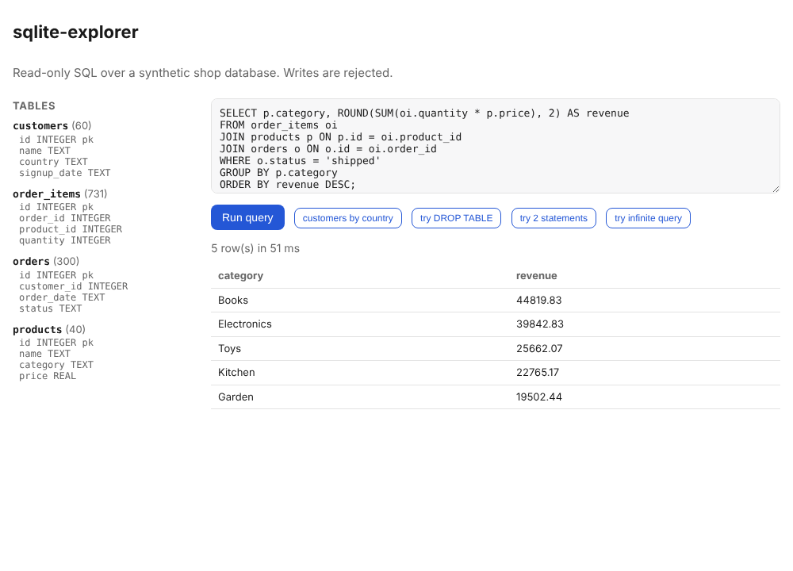

# sqlite-mcp-explorer

Read-only SQL access for AI agents over [MCP](https://modelcontextprotocol.io), with a web
console. Giving an agent a database is risky; this server is built so a bad or hostile query
cannot change data or run away.



## Safety model

Several independent layers, so one failure does not open the door:

1. **Read-only connection**: the file is opened with `mode=ro`; SQLite itself refuses writes.
2. **Authorizer allow-list**: only `SELECT`, column reads, functions and recursive CTEs are
   permitted. `DROP`, `DELETE`, `UPDATE`, `INSERT`, `CREATE`, `ALTER`, `PRAGMA`, `ATTACH`,
   `VACUUM` and `load_extension` are denied.
3. **One statement per call**, so `SELECT 1; DELETE ...` is rejected.
4. **Bounded cost**: results are capped at 200 rows (the response says if it was `truncated`),
   and a query is aborted after 2 seconds.

The tests exercise each layer, including attack queries, and check that data is unchanged
afterwards.

## Demo (no API key)

```bash
pip install -e ".[dev]"
sqlite-explorer-web                # http://127.0.0.1:8000
```

It opens a **synthetic** shop database (customers, products, orders, order items) generated
from a fixed seed; it contains no real data. The page has buttons that attempt `DROP TABLE`, a
two-statement query and an infinite recursive query, so you can watch each get rejected.

Use your own database:

```bash
SQLITE_DB=/path/to/app.db sqlite-explorer-web
```

## MCP tools

```json
{ "mcpServers": { "sqlite": { "command": "sqlite-explorer-mcp",
                              "env": { "SQLITE_DB": "/path/to/app.db" } } } }
```

| Tool | Does |
| --- | --- |
| `list_tables()` | Tables and views |
| `describe_table(table)` | Columns, types, keys, foreign keys, row count |
| `run_query(sql)` | One read-only SELECT; errors if rejected or timed out |

## Tests

```bash
python -m pytest
ruff check src tests
```

## Limitations

- SQLite only.
- A read-only query can still read anything in the file. Point it at a database (or a copy)
  that contains only data the agent may see.
- The 2-second limit stops runaway queries, but it is a per-query guard, not a rate limiter.
- No authentication on the web console; keep it on localhost.
